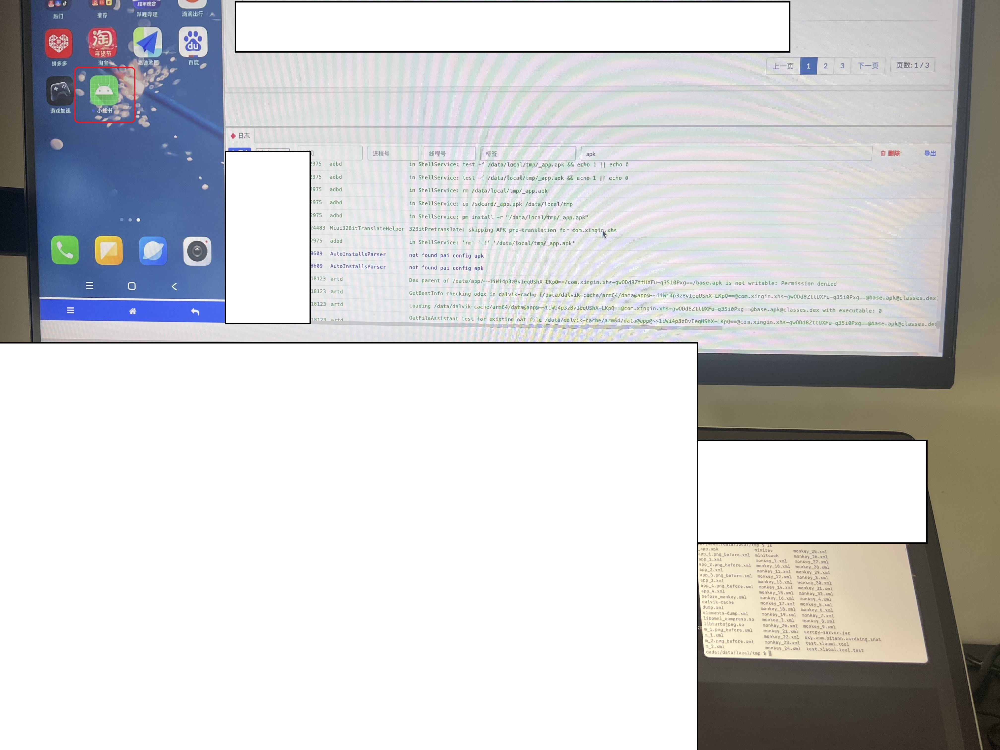
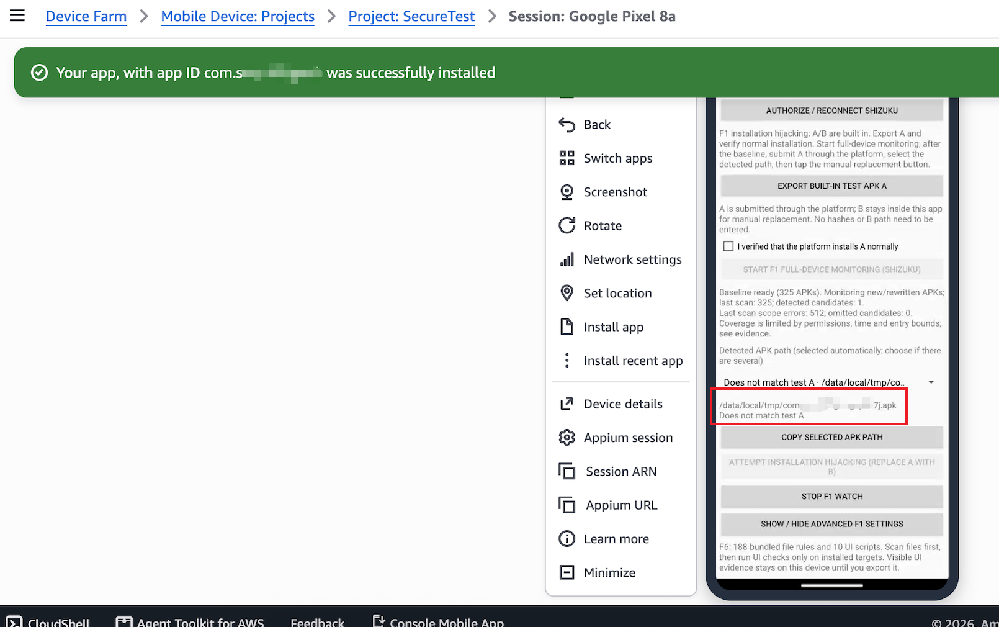
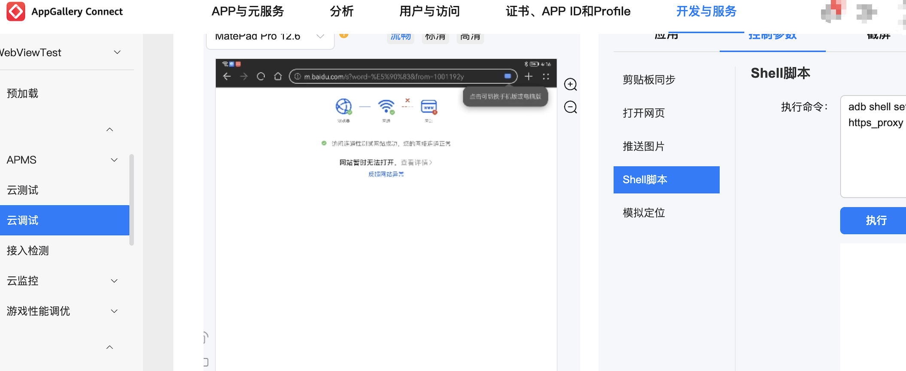

# ACTScope — Paper Artifact

ACTScope evaluates security isolation in Android cloud testing platforms through two complementary components:

| Component | Contents | Entry point |
| --- | --- | --- |
| **ADB tools** | Host scripts, platform configurations, observation evaluation, reports, and the telemetry collector | [adb_tools/](adb_tools/) |
| **Android app** | Unified on-device F1/F5/F6/F7 detection, bundled rules, and F1 replacement fixture | [Download APK](android_app/actscope-probe.apk) · [Source](android_app/) |

The sections below cover setup, experiments, and builds.

<!-- EVIDENCE:START -->

<!-- Generated by adb_tools/scripts/build_evidence_gallery.py; links are relative to the artifact root. -->

## Supporting Evidence

<div style="overflow-x:auto;max-width:100%" tabindex="0" role="region" aria-label="Supporting evidence table">
<table style="min-width:1360px;table-layout:fixed;border-collapse:collapse" border="1">
<caption>Scroll horizontally to view all items.</caption>
<thead><tr><th scope="col" width="340" style="min-width:340px;text-align:left;vertical-align:top;padding:12px">1. Installation hijacking (F1)<br><small>AppGallery Connect</small></th><th scope="col" width="340" style="min-width:340px;text-align:left;vertical-align:top;padding:12px">2. Successful installation hijacking (F1)<br><small>Xiaomi Cloud Testing Platform</small></th><th scope="col" width="340" style="min-width:340px;text-align:left;vertical-align:top;padding:12px">3. Installation-path discovery (F1)<br><small>AWS Device Farm</small></th><th scope="col" width="340" style="min-width:340px;text-align:left;vertical-align:top;padding:12px">4. Network-proxy interference (F3)<br><small>AppGallery Connect</small></th></tr></thead>
<tbody><tr><td width="340" style="min-width:340px;vertical-align:top;padding:12px"><video width="320" controls preload="metadata" playsinline style="width:320px;max-height:240px" aria-label="1. Installation hijacking (F1)"><source src="https://anonymous.4open.science/api/repo/ACTScope-1D5F/file/evidence/videos/appgellery_hijack_silent.mp4"><a href="evidence/videos/appgellery_hijack_silent.mov">Open the original video</a>.</video><p>Demonstration of installation hijacking on AppGallery Connect.</p><p><a href="https://anonymous.4open.science/api/repo/ACTScope-1D5F/file/evidence/videos/appgellery_hijack_silent.mp4">Play video</a> · <a href="evidence/videos/appgellery_hijack_silent.mov">Original video</a></p></td><td width="340" style="min-width:340px;vertical-align:top;padding:12px"><a href="evidence/images/xiaomi.jpeg"></a><p>Successful installation hijacking on Xiaomi Cloud Testing Platform, with the application icon and installation logs shown.</p><p><a href="evidence/images/xiaomi.jpeg">View full image</a></p></td><td width="340" style="min-width:340px;vertical-align:top;padding:12px"><a href="evidence/images/aws-hijack1.png"></a><p>The on-device probe identifies an APK staging path on AWS Device Farm; this image shows the discovery stage.</p><p><a href="evidence/images/aws-hijack1.png">View full image</a></p></td><td width="340" style="min-width:340px;vertical-align:top;padding:12px"><a href="evidence/images/appgellery_proxy.png"></a><p>Shell-based proxy interference on AppGallery Connect, shown alongside a browser connectivity error.</p><p><a href="evidence/images/appgellery_proxy.png">View full image</a></p></td></tr></tbody>
</table>
</div>

<!-- EVIDENCE:END -->

## Methods

| ID | Failure mode | Collection method |
| --- | --- | --- |
| F1 | Insecure Installation Artifact Handling | ADB/Shizuku staging-file probes; verify substitution against the final installed identity. |
| F2 | Installation Policy Enforcement Failure | Import observed policy effectiveness and cross-route consistency. |
| F3 | Over-privileged ADB | ADB reboot/proxy probes, with impact and recovery observations. |
| F4 | ADB Connection Residue | Fresh device challenge through old authorization after session end. |
| F5 | App Residue | Fresh post-return app telemetry received by the collector. |
| F6 | Data Residue | ADB file scan, or app file scan followed by installed-target UI workflows. |
| F7 | Privileged Access Residue | Previously granted Accessibility state in fresh post-return telemetry. |

## Quick start

**Host:** Python 3.10+, standard library only. The offline example needs no device or platform account. From the artifact root:

```sh
cd adb_tools
python3 -B -m actscope init --config configs/offline-demo.json --run-id reviewer-offline-01
python3 -B -m actscope import-observation --run runs/reviewer-offline-01 --failure F6 --file configs/observations/f6.file-confirmed.synthetic.json
python3 -B -m actscope report --run runs/reviewer-offline-01
```

Open `adb_tools/runs/reviewer-offline-01/report.md`: F6 is confirmed **for synthetic input**, not a platform measurement. Repeat with a fresh run ID.

**App:** install [ACTScope Probe](android_app/actscope-probe.apk) on Android 8+. F1 requires Shizuku with shell access; F6 UI inspection requires Accessibility, with screenshots on Android 11+. F5/F7 require a reachable HTTPS collector. F6 exports JSON and per-app screenshots to `Download/ACTScope/<unique-folder>/`.

```text
ACTScope_final/
  README.md               All usage instructions
  adb_tools/              Host CLI, configs, rules, fixtures, tests and collector
  android_app/            Android source, installable APK and f1_fixtures/ source
  evidence/               Supporting video, images and offline gallery
```

## ADB tools

All host commands below run from `adb_tools/`. Keep experimental inputs and outputs inside that workspace; copy evidence needed by an import into `runs/<run-id>/`. The root `evidence/` folder is for reviewer presentation.

### Prepare a device experiment

Copy `configs/xiaomi.json`, `configs/huawei.json`, or `configs/alltesting.json` to `configs/local-platform.json`. Fill actual ADB connection settings and verified capabilities (`null` means unknown). These are manual setup templates: platform login, Web installation, release, and device-identity verification remain operator tasks.

```sh
python3 -B -m actscope init --config configs/local-platform.json --run-id trial-01
python3 -B -m actscope capabilities --run runs/trial-01
python3 -B -m actscope event --run runs/trial-01 --type session_started --note "Platform confirmed session start"
```

Configuration is snapshotted. Retain receipts, device identity, timestamps, baselines, and recovery evidence. For delayed recording, use the actual timezone-aware ISO 8601 timestamp via `--time`.

### F1 — Insecure Installation Artifact Handling (ADB workflow)

F1 covers unauthorized access to or modification of staged APKs. The following A/B workflow tests installation substitution.

The passive [A/B APKs](adb_tools/artifacts/f1/) share a package and signing key, display distinct markers, and request no permissions or network access. Verify that A installs normally first.

```sh
python3 -B -m actscope f1 --run runs/trial-01 --duration 120 --active --baseline-verified
```

After the baseline, upload A through the platform. The script scans accessible roots (default `/`) and replaces new/rewritten APKs matching A. Omit `--active` for observation only. Access restrictions and limits are recorded.

After the original platform task completes, inspect the installed marker and save evidence. If B is verified and legitimate transformations excluded:

```sh
python3 -B -m actscope f1-finalize --run runs/trial-01 --task-id "OBSERVED_TASK_ID" --installed B --evidence runs/trial-01/f1-final.png --exclude-platform-transform
```

Use `A` or `unknown` when appropriate. Replacement success alone does not confirm hijacking; do not install B separately as confirmation.

### F2 — Installation Policy Enforcement Failure

Establish a benign installation baseline. Record the known sample identity, substantiated maliciousness, route, comparable context, and final security disposition in a copy of `configs/observations/f2.inconclusive.template.json`. No malware dataset is supplied.

```sh
python3 -B -m actscope import-observation --run runs/trial-01 --failure F2 --file runs/trial-01/f2.json
```

**F2-E:** a known malicious sample reaches the defined prohibited state at an official entry point after completed checks or an executed observation window. **F2-C:** the same APK under comparable conditions is security-blocked through one route and admitted through another. Acceptance everywhere is not a separate consistency finding; ordinary installation errors are not security blocks.

### F3/F4/F6 — Other ADB probes

**F3 — Over-privileged ADB:** copy `configs/f3-reboot.example.json` or `configs/f3-proxy.example.json` to `configs/local-f3.json`; document an independent recovery plan. For proxy testing, set `controlled_endpoint: true` only for an actual experimenter-controlled endpoint. Use separate runs for different impact cases.

```sh
python3 -B -m actscope probe --run runs/trial-01 --failure F3 --options configs/local-f3.json
python3 -B -m actscope probe --run runs/trial-01 --failure F3 --options configs/local-f3.json --active
```

The first command plans; the second executes. Proxy `roundtrip` attempts restoration; `apply` requires later `restore` with its snapshot. Confirmation requires attributed sustained unavailability and failed recovery, persistent network effects after cleanup, or verified management damage. Retain impact/recovery evidence; command success or brief disconnection is insufficient.

**F4 — ADB Connection Residue:** establish a baseline, then record confirmed return and challenge the device without renewing authorization:

```sh
python3 -B -m actscope probe --run runs/trial-01 --failure F4 --options configs/f4-baseline.json
python3 -B -m actscope event --run runs/trial-01 --type session_ended --note "Platform confirmed session end"
```

Copy `configs/f4-post.example.json` to `configs/local-f4-post.json`. Set `old_authorization_confirmed: true` only after verifying that authorization is unchanged, then run:

```sh
python3 -B -m actscope probe --run runs/trial-01 --failure F4 --options configs/local-f4-post.json
```

A fresh nonce response must follow the boundary on the same device through unchanged authorization. `adb devices` and cached connection state are insufficient.

**F6 — Data Residue:** scan rule paths over ADB:

```sh
python3 -B -m actscope probe --run runs/trial-01 --failure F6 --options configs/f6.example.json
```

Supply prior-session attribution and expected-cleanup evidence in the observation. File presence alone does not establish its origin; the on-device workflow below adds UI inspection.

## Android app

### F1 — Insecure Installation Artifact Handling (device workflow)

1. Start Shizuku using an available debugging facility and authorize ACTScope Probe. This method requires shell UID 2000; installing Shizuku alone supplies no privilege.
2. Select **Start F1 full-device monitoring (Shizuku)**. After baseline collection, manually install a tester-owned APK through the platform Web interface.
3. Select a discovered path, such as `/data/tmp/xxx.apk`, and start the hijacking attempt. The app embeds B only; no fixed-A match is required.
4. After directory monitoring starts, submit another Web installation. New or rewritten direct-child APKs in `/data/tmp` are candidates. If the filename becomes `yyy.apk`, B replaces that file while retaining `yyy.apk`. Unchanged baseline files and subdirectories are excluded. Polling is 50 ms for up to 300 seconds; avoid unrelated concurrent uploads.
5. Verify the final installed identity in that same platform task, stop monitoring, and export evidence.

Import the bundle using `import-device-probe --failure F1`, following the F6 syntax below. Supplement its observation using the F1 template and `import-observation --merge`. The host-only `f1-finalize` shortcut assumes the supplied A/B fixtures. Preserve the normal baseline, original upload identity, task association, replacement identity, and exclusion of legitimate transformations; a discovered path or successful write is insufficient.

### F6 — Data Residue: file scan, UI inspection, and export

Set the app run ID to the host run ID. Local F6 needs no collector token. Enable Accessibility; Shizuku optionally broadens file access.

Select **One-tap F6: file scan → installed-app UI**. Bundled file rules run regardless of whether target apps remain installed. UI workflows run only for installed, launchable targets; target apps are not reinstalled or updated. If Accessibility is enabled later, use **Continue F6 UI after enabling accessibility**.

Select **Export all evidence (without token)** and preserve the complete `Download/ACTScope/<unique-folder>/` directory: `actscope-device-evidence.json` plus `apps/<package>/` step JSON/PNG files. Copy it into the host run, then import:

```sh
python3 -B -m actscope import-device-probe --run runs/trial-01 --failure F6 --file runs/trial-01/device-export/actscope-device-evidence.json
```

There are 188 file rules and 10 UI scripts. Screenshots require Android 11+ and Accessibility screenshot capability; missing captures, selector mismatches, login/consent steps, and protected screens limit coverage. After an upgrade, re-enable the service if screenshot permission is stale. UI records stay local until export; telemetry never uploads them.

An accessible actual file attributable to the preceding session and expected to be cleaned confirms file residue independently of UI. Attributable prior-session UI content can separately confirm UI residue. Empty directories, public resources, installed-app presence, or completed workflows do not suffice. Preserve access/export errors and supplement provenance through the F6 observation template.

### F5/F7 — App Residue and Privileged Access Residue

From `adb_tools/`, register a run token and start the collector:

```sh
python3 -B -m actscope.telemetry init --run-id trial-01 --endpoint https://YOUR-REAL-COLLECTOR
python3 -B -m actscope.telemetry serve --host 127.0.0.1 --port 8765
```

Use a trusted HTTPS reverse proxy for `/v1/time` and `/v1/telemetry`, or collector `--certfile`/`--keyfile` options. No public server is included. The token is saved in `runs/collector/provisioning/trial-01.json`; keep it private. A custom `--data-dir` goes before the subcommand and must stay inside `adb_tools/`.

Enter the HTTPS base URL, run ID, and token in the app. Collect at least two distinct time-synchronized baseline samples. For F7, first enable Accessibility and obtain an enabled baseline query. F5 needs neither Accessibility nor Shizuku. The app also requests Device Admin and Notification Listener Access; only nullable Boolean states are transmitted, with no notification content. The current F7 oracle evaluates Accessibility only. The default 10×10-pixel overlay uses separate overlay permission.

When the platform confirms return, record its boundary:

```sh
python3 -B -m actscope.telemetry end --run-id trial-01 --note "Platform confirmed device return"
```

For delayed recording, use the observed server-clock epoch milliseconds with `--at-ms`. Host `session_ended` and collector `end` are independent records of the same boundary. Optional `ready`/`next` commands require separately observed boundaries. Recorded boundaries cannot be overwritten.

Do not relaunch or reauthorize after return. Predefine and report the observation window; WorkManager intervals are at least 15 minutes and may be delayed. Then export:

```sh
python3 -B -m actscope.telemetry export --run-id trial-01 --output runs/trial-01/telemetry.json --no-reauthorization
python3 -B -m actscope import-observation --run runs/trial-01 --failure F5 --file runs/trial-01/telemetry.json
python3 -B -m actscope import-observation --run runs/trial-01 --failure F7 --file runs/trial-01/telemetry.json
```

Use `--no-reauthorization` only when verified. Confirmation requires two fresh post-return events with matching run/installation/build identities and corrected timing. Default limits: clock uncertainty 2 seconds, calibration age 5 minutes, permission-query age 5 seconds. Boot/monotonic checks and deduplication exclude stale delivery. F7 requires a fresh enabled query for the previously granted service, without proving screen-reading ability. Missing telemetry cannot prove cleanup; device exports cannot replace collector records.

## Reports and builds

### Observation fields and report interpretation

```sh
python3 -B -m actscope report --run runs/trial-01
```

Reports are written as Markdown, JSON, and CSV. `confirmed` means the supplied observations meet the failure conditions; `not_observed` is limited to completed observations; `inconclusive` means evidence is insufficient; `not_applicable` means the required capability is absent.

Use `configs/observations/` templates and keep unknown values `null`. Remove template `_example` metadata only after replacing it with genuine measurements; synthetic flags remain visible in reports. `import-observation --merge` recursively merges dictionaries but **replaces arrays**. Retain every entry intended to survive a merge. Each complete observation and evaluation is appended to `evidence.jsonl`; reports show the latest observation per failure.

Key evidence groups are F1 baseline/task/final identity; F2 sample and `channels[]`; F3 impact/recovery `cases[]`; F4 baseline, confirmed boundary, and fresh `probe`; F5/F7 collector-generated `events[]`; F6 attributed `files[]` and `ui[]` with coverage/errors. Exact fields are in the templates and [oracles.py](adb_tools/actscope/oracles.py). Operator assertions are not independently authenticated, and the local log is not tamper-proof.

### Build Android artifacts and run host tests

Use JDK 17, Android SDK 35, and the included Gradle wrapper. Set `JAVA_HOME` and `ANDROID_HOME` or `ANDROID_SDK_ROOT`. Initial dependency downloads need network access. From the artifact root:

```sh
./android_app/f1_fixtures/build-local.sh
python3 android_app/scripts/refresh-builtin-rules.py
./android_app/build-local.sh :app:assembleDebug :app:lintDebug
```

Build fixtures first so embedded B matches their manifest. A/B outputs go to `adb_tools/artifacts/f1/`; the probe output is `android_app/app/build/outputs/apk/debug/app-debug.apk`. Signing keys are generated locally and are not distributed, so rebuilt APKs generally require fresh installation. Record the new build identity. App package: `org.actscope.probe`; minimum API 26, target API 34, compile API 35.

Run the host regression suite from `adb_tools/`:

```sh
python3 -B scripts/run_tests.py
```

These checks use synthetic observations and local fixtures; passing them does not establish platform findings.

For submission maintenance, put media in `evidence/videos/` or `evidence/images/`, update `evidence/catalog.json`, then run from the artifact root:

```sh
python3 adb_tools/scripts/build_evidence_gallery.py
```

The gallery generator updates the marked evidence section in this README and the offline gallery.

